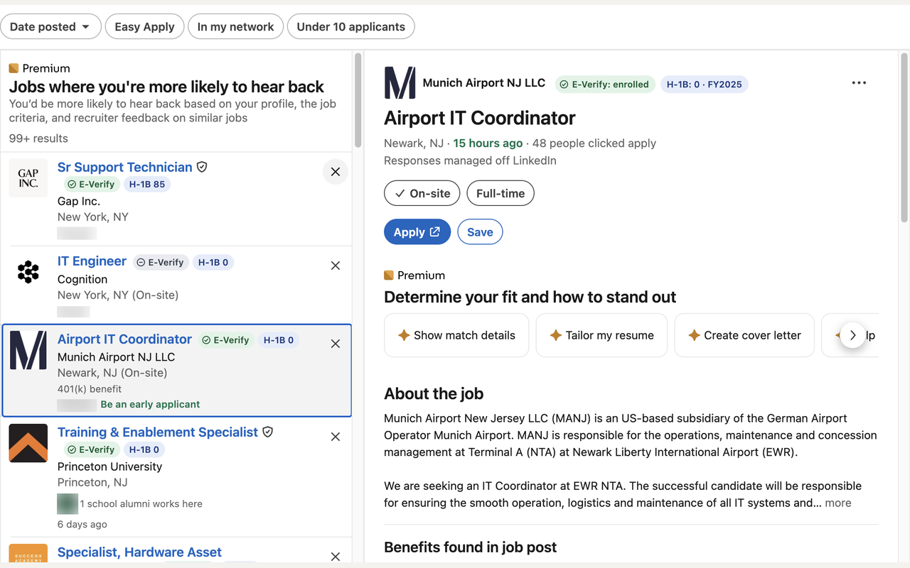
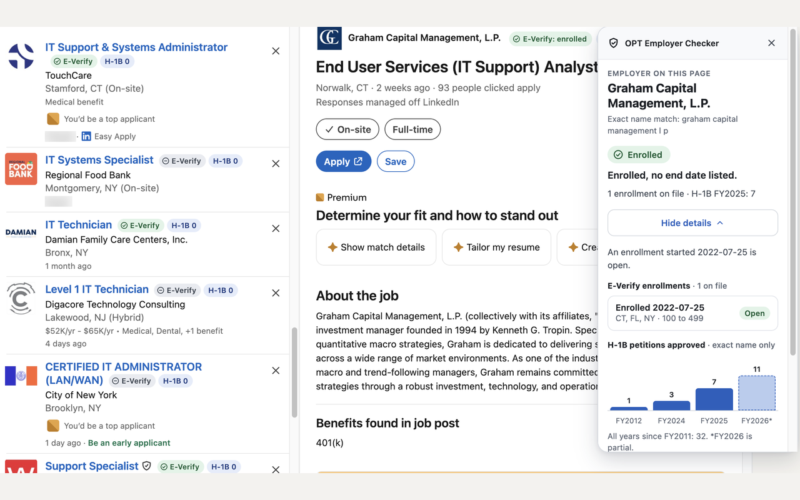

A free Chrome extension that shows **E-Verify** and **H-1B** information next to employers on LinkedIn job pages, so F-1 and STEM OPT job seekers can spot problems *before* they accept an offer.

**[Install from the Chrome Web Store](https://chromewebstore.google.com/detail/opt-employer-checker/jcdgingcdeeghlegpohgceclekoaacod)** (v1.0.1, free)

> **It cannot tell you an employer will sign an I-983.** This is not legal advice. Your DSO is the authority. Unofficial: not affiliated with DHS, USCIS, E-Verify or LinkedIn.

**More on the About page:** <https://markplowwright.github.io/opt-employer-checker/> (what the chips mean, data date and sources, privacy). **Why it is built this way:** [CASE-STUDY.md](CASE-STUDY.md).

## What it shows

| Chip | Meaning |
|---|---|
| `E-Verify: enrolled` | An open E-Verify enrollment is on file |
| `E-Verify: ended` | Only ended enrollments are on file |
| `E-Verify: not found` | Not in our data. **Not a verdict**: coverage is over 99% of what the dashboard lists, so an enrolled employer can still be missing |
| `E-Verify: couldn't check` | The data could not be loaded. Never means "not enrolled" |
| `H-1B: 12 · FY2025` | 12 H-1B petitions approved in the latest full fiscal year (a `*` marks a partial year) |

Click a chip for the details: enrollment dates, a few years of H-1B history, the data date, and links to the sources.

## Rules the extension follows

- A match must be an **exact name match after normalizing**. A similar-looking name is never shown as a match, and it never shows green on a fuzzy match.
- "Not found" and "couldn't check" are always shown as such, never as a "no".
- The data date and a source link are always visible.
- Some E-Verify enrollments cover only federal-contract work, and the panel says so.

## Privacy

- Company names **never leave your browser**. The name is normalized and hashed locally, and only the first 3 hex characters of the hash are requested (one of 4,096 shard files shared by hundreds of employers), so the data host cannot tell which employer you looked at.
- No server, accounts, analytics or tracking. The data is static files on GitHub Pages; like any website, GitHub can see your IP address and which shard was requested.
- Downloaded shards are kept in the browser's own cache so lookups are fast.
- The extension only runs on linkedin.com and only talks to this project's data site.

## How it works

1. `data-pipeline/` builds an index from public data (E-Verify employer list, USCIS H-1B Employer Data Hub) with Python, standard library only.
2. It splits the index into 4,096 shards keyed by the first 3 hex characters of the SHA-256 of the normalized name, under a versioned path (`<data_date>/<prefix>.json`) so they cache forever.
3. A GitHub Actions workflow publishes the shards to GitHub Pages. They are not committed to git.
4. `extension/` (Manifest V3) reads the company name on the LinkedIn page, hashes it, fetches one shard, and draws the chips in a shadow DOM (text only, no HTML injection).

## Install

1. Open the [OPT Employer Checker page on the Chrome Web Store](https://chromewebstore.google.com/detail/opt-employer-checker/jcdgingcdeeghlegpohgceclekoaacod) and click **Add to Chrome**.
2. Open LinkedIn Jobs.

To run it from source instead (for development): clone this repo, open `chrome://extensions`, turn on **Developer mode**, click **Load unpacked**, and choose the `extension/` folder.

## Develop

    cd extension && npm install && npm test      # extension tests (node:test)
    cd data-pipeline && python3 -m unittest      # pipeline tests

## Layout

- `extension/` the Chrome extension (MV3)
- `data-pipeline/` builds the index and shards from public data
- `site/` the data site's About page (published with the shards)
- `brand/` logo files
- `assets/screenshots/` screenshots used here and for the Store listing

## License

The code is [MIT licensed](LICENSE). The data comes from public U.S. government sources (E-Verify and the USCIS H-1B Employer Data Hub); it is not covered by this license.

## Status

Version 1.0.1, [live on the Chrome Web Store](https://chromewebstore.google.com/detail/opt-employer-checker/jcdgingcdeeghlegpohgceclekoaacod). First released 2026-11-21; 1.0.1 adds a popup you can drag by its title bar. LinkedIn only. Next: an employer search page, more job sites, regular data refreshes.
